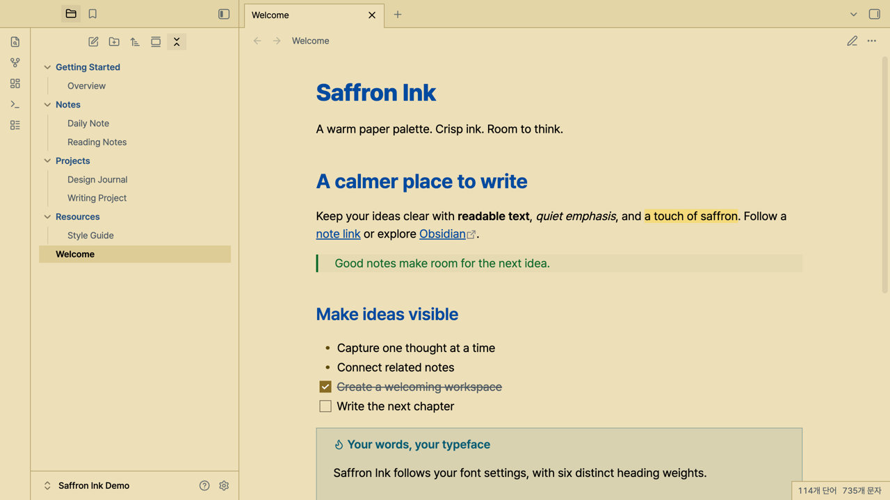
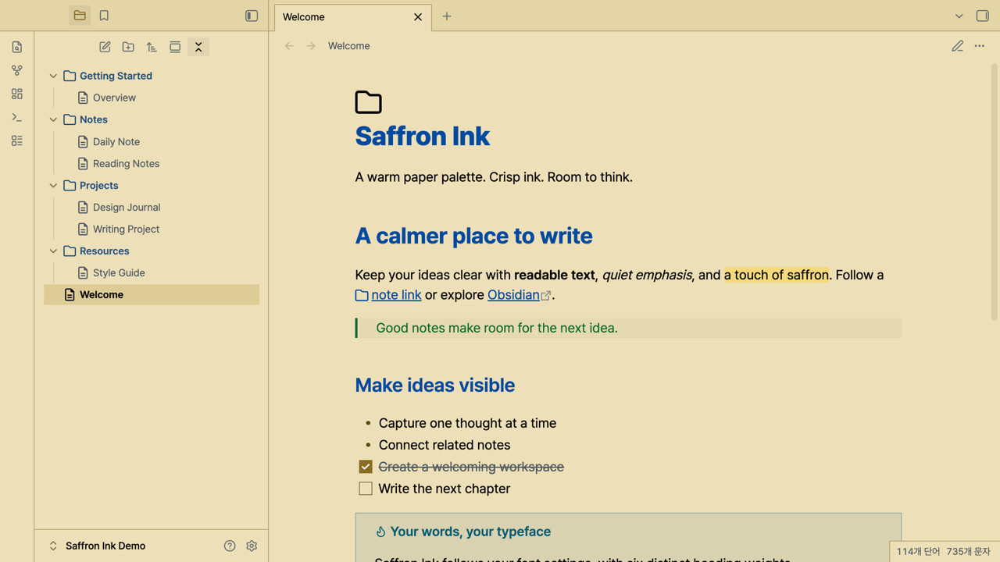

# Saffron Ink

A warm, high-contrast light theme for Obsidian, inspired by saffron paper and crisp ink. Blue headings, a restrained golden accent, and six distinct heading weights help give your notes structure.



## Features

- Warm paper background with dark, readable text.
- Six heading weights, from H1 at 800 to H6 at 300.
- Bolder folder names in a muted blue blended with the heading color.
- Clear selection and keyboard focus, with square tabs and controls.
- Styles for links, quotes, tables, tasks, callouts, properties, and code.
- Your own fonts and base text size, without bundled fonts or remote assets.

## Compatibility

Saffron Ink supports **light mode** and requires **Obsidian 1.14.4 or later**. It was tested on macOS desktop. Mobile layouts have not yet been verified. Dark mode uses Obsidian's default dark styling.

Heading weights are 800, 700, 600, 500, 400, and 300. Variable fonts and static fonts with these weights installed can display the full range. Fonts with fewer available weights may make some levels look similar. CSS snippets can override the theme.

The screenshot uses a separate demonstration vault containing only sample notes. Pretendard Variable and JetBatang NF were selected for the preview; neither font is required or installed by this theme.

## Installation

Once the theme is listed in the Community directory:

1. Open **Settings → Appearance → Themes → Manage**.
2. Search for **Saffron Ink** and select **Install and use**.
3. Set the base color scheme to **Light**.

For manual installation, download `theme.css` and `manifest.json` from a published [GitHub release](https://github.com/andrwj/obsidian-theme-saffron-ink/releases), then place both files in:

```text
<Vault>/.obsidian/themes/Saffron Ink/
```

Restart Obsidian if the theme is not visible, or after updating its manifest. Select Saffron Ink under Appearance. Published releases are available on GitHub. Community installation becomes available after the theme is accepted into the directory.

## Optional Font Awesome icons

File explorer icons are supplied by **GlyphIt**, rather than by the theme. The theme works without this plugin.

To reproduce the optional icon preview:

1. Install and enable [GlyphIt](https://community.obsidian.md/plugins/glyphit).
2. In GlyphIt settings, add the **Font Awesome Free Regular** icon pack. The preview uses Font Awesome Free 6.5.1.
3. Add a `^.*$` rule for **folders** using `folder`, and a separate `^.*$` rule for **files** using `file-lines`. Select the Regular icons from the Font Awesome pack.

The identifiers in this preview's pack are `FarRegularFolder` and `FarRegularFileLines`. See [the rule preset](configs/glyphit-rules.json); merge it with existing rules rather than replacing the plugin's entire settings file. More specific custom rules should precede the defaults.



GlyphIt manages and caches the icon pack locally. Saffron Ink does not download plugins, fonts, or icon packs. Font Awesome is not bundled with this theme and retains its [own license](https://fontawesome.com/license/free).

## Development

Node.js 22 or later is required for development tools, but not for using the theme.

```sh
npm ci
npm run check
npm run install:local -- /path/to/vault
```

The install command copies only `theme.css` and `manifest.json`. It preserves notes, plugins, font settings, and the selected theme.

Use [the sample note](examples/theme-preview.md) to compare reading mode, Live Preview, and source mode. The optional `npm run verify:render` command tests styles against an installed Obsidian `app.css`; it requires Playwright Chromium (`npx playwright install chromium`). On platforms other than macOS, supply the stylesheet through `OBSIDIAN_APP_CSS`.

```sh
npm run check:submission
npm run release:prepare
```

Release preparation creates the two upload assets under `artifacts/release/1.0.1/`. Local agent instructions, working notes, test artifacts, and development tools are excluded from the release assets. See [the release checklist](docs/release-checklist.md).

## Credits and license

MIT. The palette is ported from [Saffron Ink for VS Code](https://github.com/andrwj/saffron-ink-vscode-theme), which was derived from Hyzeta's [Github Light Theme Gray](https://marketplace.visualstudio.com/items?itemName=Hyzeta.vscode-theme-github-light).

This Obsidian stylesheet is implemented separately for Obsidian's CSS variables and Markdown views. The original MIT notice, **Copyright 2020 Ling CHU**, is preserved in [LICENSE](LICENSE).
